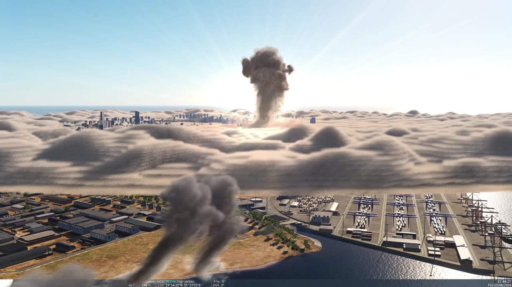
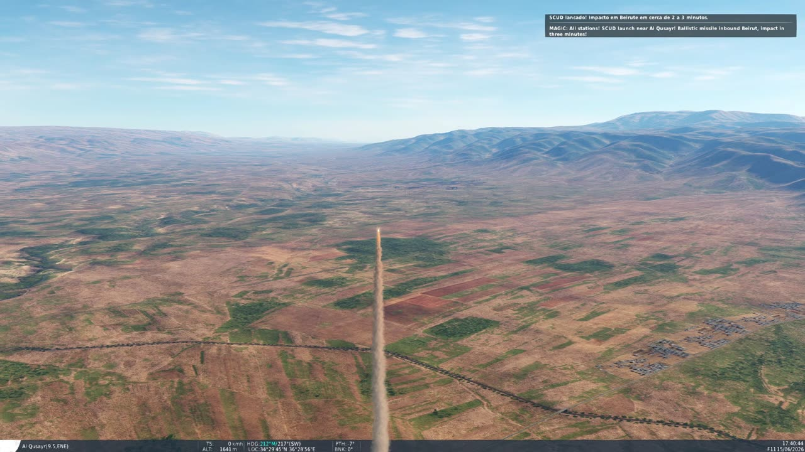
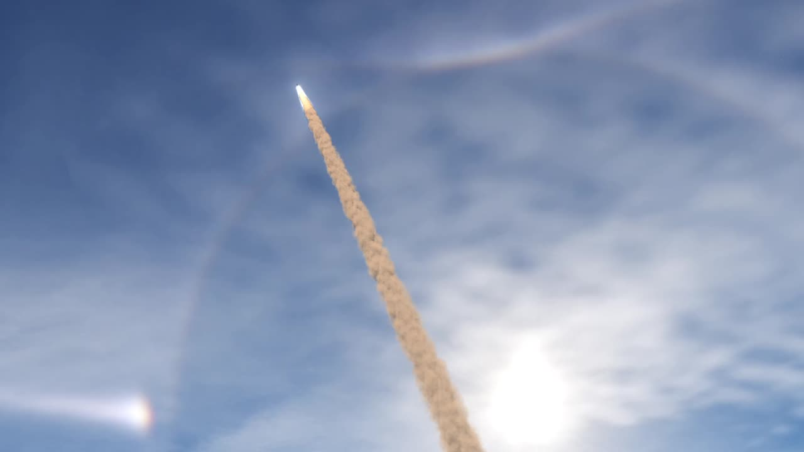
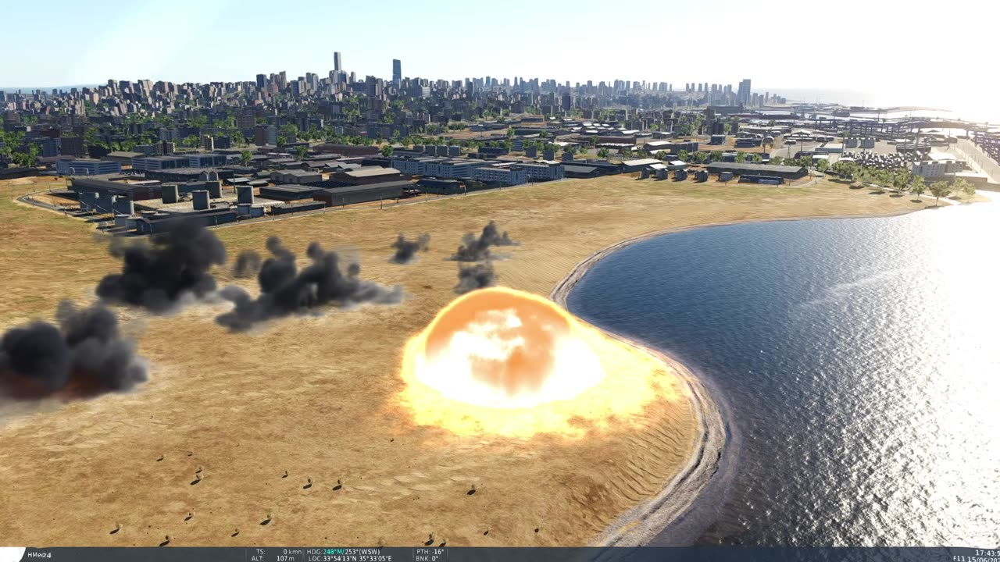
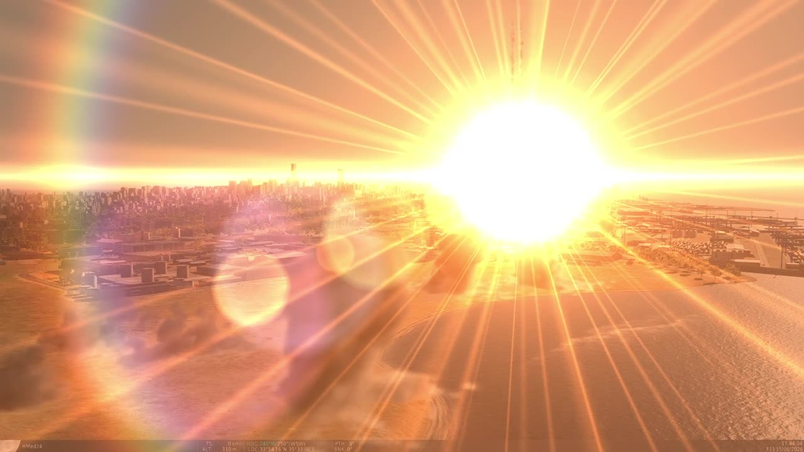
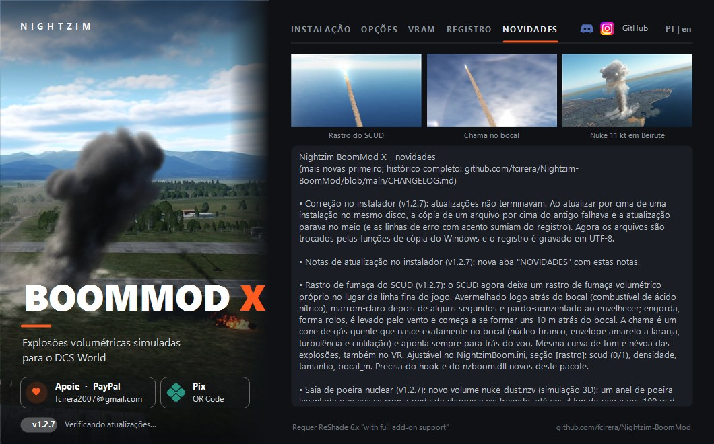

# Nightzim BoomMod

## Nightzim BoomMod X - volumetric explosions for DCS World

**Latest: BoomMod X v1.2.8** - OptiScaler/upscaler compatibility, VR fixes, nuclear dust without stripes. Download: https://github.com/fcirera/Nightzim-BoomMod/releases/latest

*Português abaixo.*

BoomMod X draws simulated explosions in 3D inside the game. A ReShade add-on ray-marches pre-computed explosion volumes (fluid simulations of the blast, fire and smoke) on top of the image, using the scene depth, the sun and the mission wind. A Lua hook triggers them from the real bombs, rockets, missiles and tank shells, in single player and multiplayer.

| | |
|---|---|
|  |  |
| **SCUD smoke trail (v1.2.7)** - volumetric, reddish at the nozzle, light brown and greyish brown as it ages | **Hot-gas flame (v1.2.7)** - cone from the nozzle, white core, yellow to orange, always along the flight path |
|  |  |
| **Volumetric explosions** - JDAM, Mk-82, rockets, air burst, napalm, tank shell | **SCUD = 11 kt nuke** - flash, lens effects, shock wave, 1.3 km mushroom |

### Features

- **Explosions:** JDAM (2000 lb, new and classic), Mk-82 (New Shader, 6 variations), rockets (New Shader, 4 variations), air burst, napalm (ignites from end to end along the bomb's heading) and tank shell. Each one is rotated/mirrored at random and drifts with the real wind.
- **SCUD = nuclear (11 kt):** yellow-white flash, blinding glare with rays and lens effects that turn with your head, view darkened while the eye readapts, air refraction and camera shake when the shock wave arrives, a 1.3 km mushroom cloud, a dust skirt that grows with the shock wave (about 4 km) and a blast heard up to 90 km away. Options: *SCUD missile explosion = Nuke 11kt / Same as JDAM*.
- **SCUD smoke trail and flame:** the SCUD leaves its own volumetric trail and a hot-gas flame cone instead of the game's thin line (`NightzimBoom.ini`, section `[rastro]`).
- **Missions can request explosions:** a mission script can add `"x,y,z,type"` to the global table `nzx` (for example type 9 = nuclear).
- **VR (OpenXR):** drawn inside the headset, once per eye (Quest Link, Virtual Desktop).
- **Targeting pod** (explosions in the MFD image) and **night lighting** (smoke lit by the fire).
- **VRAM control:** choose how many variations of each explosion to load, the explosion limit and BC7 compression; the installer adds up the video memory as you choose.
- **Installer:** install / disable / uninstall with backups; Options, VRAM, Log and What's new tabs; ReShade check; update check; Portuguese and English.

### Requirements and install

- DCS World (DirectX 11) and **ReShade 6.x with full add-on support** installed for `bin\DCS.exe` (DirectX 10/11/12; the OpenXR option of the ReShade installer is not needed, VR included).
- Download the zip from the [latest release](https://github.com/fcirera/Nightzim-BoomMod/releases/latest), extract it whole, close DCS, run `BoomModX_Instalador.exe` and click **Install / Activate**. To update, run the new installer over the old install (your `NightzimBoom.ini` is kept).
- The visual effects run on your PC, so you see them on any server; players without the mod see the stock explosions.

VR notes: after entering the cockpit, give it up to a minute before the first explosion so the add-on can find the game camera. VR uses a lighter ray-march quality.

More: how it works and what every file does in [BoomModX.md](BoomModX.md), every update in [CHANGELOG.md](CHANGELOG.md), sources and current build in [`boommod-x/`](boommod-x/).

### Português

BoomMod X desenha explosões simuladas em 3D dentro do jogo: um add-on do ReShade percorre volumes de explosão pré-calculados (simulação de fluido da onda, do fogo e da fumaça) por cima da imagem, usando a profundidade da cena, o sol e o vento da missão, e um hook Lua dispara as explosões a partir das bombas, foguetes, mísseis e tiros de tanque reais, no single player e no multiplayer.

- **v1.2.8:** compatibilidade com o OptiScaler (o instalador detecta e resolve o conflito do `dxgi.dll`; ver [docs/COMPATIBILIDADE.md](docs/COMPATIBILIDADE.md)); profundidade com DLSS/FSR/XeSS; no VR, rastro do SCUD sempre desenhado e nuke não gira mais 90°; poeira nuclear sem listras horizontais.
- **v1.2.7:** rastro de fumaça volumétrico próprio do SCUD e chama em cone de gás quente saindo do bocal; saia de poeira nuclear que cresce com a onda de choque (~4 km); opções do instalador enxutas; aba NOVIDADES no instalador; correção das atualizações.
- **SCUD nuclear (11 kt):** clarão, efeitos de lente que giram com a cabeça, vista se readaptando, refração do ar e tranco na chegada da onda, cogumelo de 1,3 km e estrondo ouvido a 90 km.
- **Explosões:** JDAM, Mk-82 e foguete (Novo Shader), explosão aérea, napalm e tiro de tanque, girando ao acaso e levadas pelo vento real.
- **VR (OpenXR), pod de mira, iluminação noturna, controle de VRAM** e instalador com backup, em português e inglês.

Requisitos: DCS World (DirectX 11) e **ReShade 6.x "with full add-on support"** no `bin\DCS.exe`. Instalação: baixe o zip do [último release](https://github.com/fcirera/Nightzim-BoomMod/releases/latest), extraia inteiro, feche o DCS, abra o `BoomModX_Instalador.exe` e clique em **INSTALAR / ATIVAR**.

---

## Classic BoomMod (particle effects, v3.x)

The original line of the mod, which replaces the stock particle effects. Kept here for reference; BoomMod X above is the current one.

Physically simulated explosion effects for **DCS World**.

**Video (stock effects vs. mod, side by side):** https://youtu.be/ScPUO9IXvjo

Simulation renders of the other warheads:

- Rocket / small explosion: https://youtu.be/Lwa2Qc4Zwtc
- Medium bomb: https://youtu.be/Y25AtSTF7u8
- Napalm: https://youtu.be/-kpGMlM3ZQs
- Tank shell impact: https://youtu.be/gMRdXqjrats

Instead of hand-drawing an explosion, BoomMod simulates it: a custom solver computes the blast wave, combustion and buoyant rise of the hot gases, and that physics is what builds the mushroom cloud. The result is converted to DCS's own particle format (`.ffx`).

- Does **not** touch shaders or `Config\Effects` - passes the multiplayer integrity check
- Same particle budget as the stock effects (1024 per effect)
- Original files are backed up (with SHA-256) and can be restored at any time

## What is replaced

| DCS effect | BoomMod file | Used for |
|---|---|---|
| `airExplosion_01` | `nightzim_air_02` | air burst |
| `groundExplosion_big` | `nightzim_jdam_01` | large bombs (2000 lb class) |
| `groundExplosion_03_01` | `nightzim_mk82_01` | medium bombs |
| `groundExplosion_nar` | `nightzim_nar_01` | rockets / small warheads |
| `groundExplosion_napalm` | `nightzim_napalm_01` | napalm |
| `T90A_shot_exp_b` | `nightzim_tankshot_01` | tank shell impact |

**Download (classic):** https://github.com/fcirera/Nightzim-BoomMod/releases/tag/v3.2c

## Beta

**v3.3 beta** (feedback from r/hoggit): grey-brown smoke instead of black, smaller and denser particles at the base, visible initial expansion, stronger inverted cone of earth and debris. Files in `beta/`; download from the [v3.3-beta pre-release](https://github.com/fcirera/Nightzim-BoomMod/releases/tag/v3.3-beta). Same installer, same IC-safe method. Run the v3.2c installer again to go back.

## Install

1. Close DCS.
2. Download `Nightzim_BoomMod_v3.2c_installer.zip` from the [latest release](https://github.com/fcirera/Nightzim-BoomMod/releases/latest), extract the .bat, run it and choose **1** (install) or **2** (restore originals).
3. After a DCS update or repair, run it again.

The installer menu is currently in Portuguese. Backups are kept in `Saved Games\DCS\Nightzim BoomMod\Backup`.

### Option B - OVGME / mod manager

Download `Nightzim_BoomMod_v3.2c_OVGME.zip` from the [latest release](https://github.com/fcirera/Nightzim-BoomMod/releases/latest), put it (or the extracted `Nightzim BoomMod v3.2c` folder) in your OVGME mods folder for the DCS **game root** (not Saved Games) and enable it. The mod manager keeps its own backup of the original files. After a DCS update or repair, disable and re-enable the mod.

Use either the .bat installer or the mod manager, not both.

## Known limits

- Medium explosions sometimes use a stock preset defined in `Config`, which the mod cannot replace without failing the integrity check.
- Smoke colour ageing is approximated through the glow channel, so smoke is slightly luminous at night.

## What would unlock more in DCS

1. Per-particle colour over lifetime (today: one `SmokeColor` per effect)
2. More than 1024 particles per effect, with distance LOD
3. Per-particle size
4. Black-body colour ramp instead of a fixed temperature^4 glow
5. User effects in Saved Games that can pass the integrity check
6. A separate long-lived ground-dust layer

## Support

If you enjoy the mod, **buy me a module** - it keeps me motivated to keep improving the sim's effects. Every penny is welcome.

PayPal: `fcirera2007@gmail.com`

## Contact

Questions and suggestions are welcome. Discord ID: `999680611314831390`

## Status

Classic line: version 3.2c. BoomMod X: v1.2.8. This repository contains the mod files and the installers. The simulation engine and the `.ffx` exporter are not published here.

Not affiliated with Eagle Dynamics. DCS World is a trademark of its owner.
